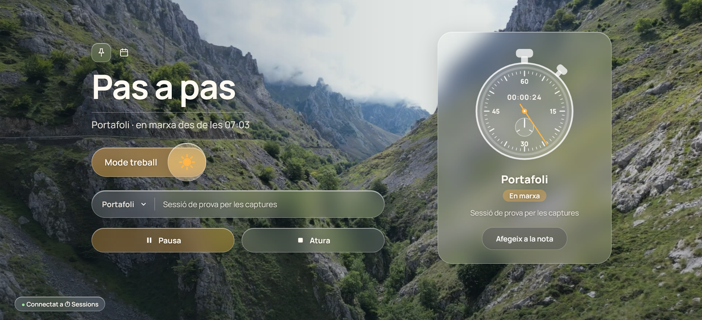
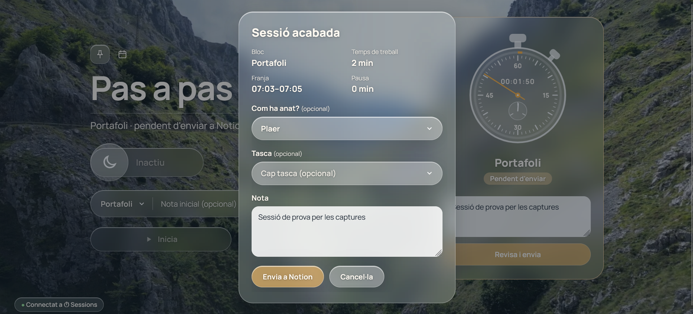
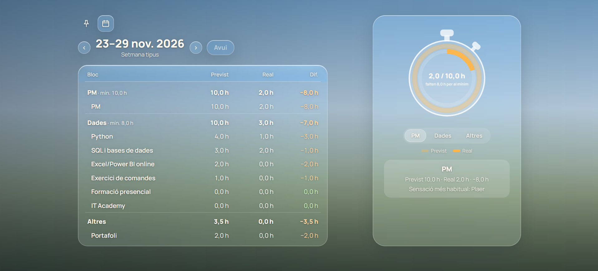

# ⏱ NotionCronoTool

Cronòmetre d'hores d'estudi per blocs que desa cada sessió a **Notion** i mostra, setmana a setmana, les **hores previstes davant de les reals**.

Una pàgina al navegador, en local, amb estètica de vidre esmerilat: tries el bloc, prems *Inicia*, i en acabar la sessió arriba sola a la teva base de dades de Notion.

| Inici | Final de sessió | Vista setmanal |
|---|---|---|
|  |  |  |

---

## Què fa

- **Cronòmetre per blocs** (PM, Python, SQL…): iniciar, pausar, reprendre i aturar. Una esfera de cronòmetre analògic mostra el temps.
- **Límit de 3 h de temps actiu** per sessió, amb un missatge per descansar (i notificació del navegador si la pestanya no es veu).
- **Final de sessió revisable:** resum, nota, sensació (Plaer, Neutre, Peatge) i tasca de Notion opcional. *Envia*, *Cancel·la* (queda pendent) o *Descarta*.
- **No es perd cap sessió:** si recarregues o tanques la pestanya, continua on era; si Notion no respon, la sessió espera en una cua local i s'envia sola.
- **Vista setmanal:** previst davant de real per bloc, els mínims setmanals (PM 10 h, Dades 8 h) i la sensació més habitual de cada bloc.
- **Conviu amb el registre manual:** les sessions que entres a mà a Notion també compten.
- **Arrencada amb un doble clic** (`start.bat`).

---

## Guia d'ús

### Què necessites

- Un ordinador amb **Windows** i connexió a internet.
- **Python 3.15** (gratuït).
- Un compte de **Notion** amb dues bases de dades (més avall tens l'estructura exacta).

### 1. Instal·lar Python

1. Descarrega'l de [python.org/downloads](https://www.python.org/downloads/).
2. A la primera pantalla de l'instal·lador, marca **«Add python.exe to PATH»** i prem *Install Now*.

### 2. Descarregar l'eina

A GitHub, botó verd **Code → Download ZIP**, i descomprimeix-lo on vulguis (per exemple, a *Documents*).

### 3. Preparar l'entorn (una sola vegada)

Obre **PowerShell** dins la carpeta de l'eina (a l'explorador: clic a la barra d'adreces, escriu `powershell` i prem Enter) i escriu aquestes ordres una a una:

```powershell
py -3.15 -m venv .venv
.\.venv\Scripts\Activate.ps1
pip install -r requirements.txt
```

- La primera crea un **entorn virtual**: una carpeta (`.venv`) amb les peces que l'eina necessita, separades de la resta de l'ordinador.
- La segona l'activa (veuràs `(.venv)` al principi de la línia).
- La tercera instal·la les tres llibreries que fa servir l'eina (Flask, python-dotenv i notion-client).

> Si PowerShell diu que no pot executar scripts, escriu una vegada `Set-ExecutionPolicy -Scope CurrentUser RemoteSigned` i torna-ho a provar.

### 4. Preparar Notion

**Les dues bases de dades.** Els noms de les propietats han de coincidir exactament:

| ⏱ Sessions (l'eina hi escriu) | Tipus |
|---|---|
| `Sessió` | Títol |
| `Bloc` | Select (una opció per bloc: PM, Python…) |
| `Franja` | Data, amb hora d'inici i de final |
| `Pausa (min)` | Número |
| `Hores` | Fórmula: (durada de la franja − pausa) en hores |
| `Tasca` | Relació amb ✅ Tasques |
| `Sensació` | Select: Plaer, Neutre, Peatge |
| `Nota` | Text |
| `Origen` | Select: Manual, Eina |

| ✅ Tasques (l'eina només la llegeix) | Tipus |
|---|---|
| `Nom` | Títol |
| `Estat` | Estat (les tasques en *Fet*, *Done* o *Arxivat* no surten a l'eina) |

**La connexió (el «permís» perquè l'eina entri a Notion):**

1. Ves a [notion.so/profile/integrations](https://www.notion.so/profile/integrations) i crea una connexió nova amb **API token**. Posa-li de nom `NotionCronoTool`.
2. Copia el **token** (comença per `ntn_`). És secret: no el comparteixis.
3. Obre ⏱ Sessions, menú **«…» → Connexions** i afegeix-hi `NotionCronoTool`. Fes el mateix a ✅ Tasques.
4. Copia l'**identificador de la font de dades** (*data source ID*) de cada base de dades: menú de la base de dades → *Gestiona les fonts de dades* → «…» → *Copia l'ID*.

> L'eina **mai** crea, modifica ni esborra bases de dades ni propietats: només crea files a ⏱ Sessions. Si l'estructura no és la que espera, no hi escriu res i t'avisa.

### 5. Posar les claus al fitxer `.env`

A PowerShell, dins la carpeta de l'eina:

```powershell
Copy-Item .env.example .env
```

Obre el `.env` amb el Bloc de notes i omple les tres línies (sense espais ni cometes):

```
NOTION_TOKEN=ntn_...
NOTION_SESSIONS_DS_ID=...
NOTION_TASKS_DS_ID=...
```

El `.env` és personal i no es puja mai al repositori.

### 6. Les teves hores previstes

La primera vegada que obris l'eina es crearà `config/plan.toml` a partir de l'exemple. Obre'l amb el Bloc de notes i posa-hi les teves hores:

- `[weeks.default]`: la **setmana tipus**, que es fa servir per a totes les setmanes.
- `[weeks."2027-01-04"]`: una **setmana especial**, amb la data del dilluns. Pots afegir-ne tantes com vulguis.
- `[groups.PM]` i `[groups.Dades]`: quins blocs formen cada grup i el seu **mínim setmanal**.

També hi pots canviar el títol, el límit de temps i el missatge del límit. Els canvis s'apliquen en recarregar la pàgina. Aquest fitxer és personal i no es puja al repositori.

**Els blocs** no es configuren aquí: surten de les opcions de la propietat `Bloc` de Notion. Si n'hi afegeixes un, apareix sol a l'eina.

### 7. Vídeo de fons (opcional)

Posa un vídeo `.mp4` a la carpeta `static/media/` (per exemple, un de llicència lliure de [Pexels](https://www.pexels.com/)) i escriu-ne el nom a `background_video`, dins `config/plan.toml`. Millor en **720p o 1080p**: el 4K fa treballar molt l'ordinador. Sense vídeo es mostra un degradat de muntanya.

### 8. Obrir l'eina

Fes **doble clic a `start.bat`**. S'obrirà una finestra negra (no la tanquis mentre facis servir l'eina) i, al cap d'un moment, el navegador.

**Drecera a l'escriptori:** botó dret sobre `start.bat` → *Mostra més opcions* → *Envia a* → *Escriptori (crea una drecera)*.

Per tancar l'eina, tanca la finestra negra.

---

### Ús diari

1. Tria un **bloc** i, si vols, escriu una **nota inicial** («Avui toca acabar el curs»). Prem **Inicia**.
2. **Pausa** i **Reprèn** tantes vegades com calgui (el toggle *Mode treball* i el polsador de dalt del rellotge fan el mateix). Amb **Afegeix a la nota** pots completar la nota.
3. Prem **Atura**. Al resum pots triar la **sensació** i la **tasca**, i retocar la nota. Després:
   - **Envia a Notion**: crea la fila a ⏱ Sessions.
   - **Cancel·la**: la sessió queda pendent (botó *Revisa i envia*).
   - **Descarta**: la llença, sense enviar res.
4. A la pestanya 📅 tens la **vista setmanal**: navega entre setmanes, canvia entre *PM*, *Dades* i *Altres*, i clica una porció de l'esfera per veure'n el detall.

**No es perd res:** la sessió en curs es desa al navegador (fes servir sempre el mateix navegador). Si Notion no respon en enviar, la sessió es guarda a `data/queue.json` i s'envia sola quan torna la connexió.

### Si alguna cosa falla

| Què veus | Què fer |
|---|---|
| «No connectat: Notion no accepta el token» | Revisa `NOTION_TOKEN` al `.env` i torna a obrir l'eina (el `.env` només es llegeix en arrencar). |
| «No es troba la base de dades» | Revisa els identificadors del `.env` i que la connexió tingui accés a les dues bases de dades (*Connexions*). |
| «No s'hi enviarà res fins que ho arreglis a Notion: …» | A ⏱ Sessions falta una propietat o una opció. El missatge diu quina. |
| «N sessions pendents d'enviar a Notion» | Notion no responia. Es tornaran a enviar soles quan hi hagi connexió. |
| La finestra negra diu que falta `.venv` o `.env` | Repeteix el pas 3 o el 5 d'aquesta guia. |
| El vídeo va a batzegades | Fes servir una versió de 720p o deixa `background_video` buit. |

---

## Sobre el projecte

*Projecte personal i peça de portafoli de gestió de projectes. Desenvolupat amb l'ajuda de [Claude Code](https://claude.com/claude-code), en una de les primeres experiències amb l'eina.*

### Problema i objectiu

Segueixo un pla d'estudi amb hores previstes per bloc. Sense un registre, la revisió setmanal del pla es feia de memòria i no era fiable.

**Objectiu:** registrar amb un clic el temps real de cada bloc, desar-lo a Notion i veure cada setmana les hores previstes davant de les reals.

### Com s'ha gestionat

- **Especificació primer.** Abans de cap línia de codi: problema, usuari, abast (dins i fora de la v1), vuit històries d'usuari amb criteris d'acceptació, model de dades i supòsits ([SPEC.md](SPEC.md)).
- **Sis fases incrementals**, cadascuna amb el mateix cicle: pla curt → aprovació → construcció → **prova manual** per part de l'usuari → correccions → **commit**.
- **Gestió del canvi.** Provar la interfície real va fer aflorar millores (un modal de revisió, blocs llegits de Notion, una vista setmanal interactiva). Cada canvi d'abast es va decidir explícitament, amb el motiu i l'impacte en el temps, i queda documentat al [Registre de canvis](SPEC.md#9-registre-de-canvis) (12 canvis).
- **Privacitat per disseny.** Secrets fora del codi (`.env`), pla personal fora del repositori, i revisió completa de l'historial abans de publicar-lo.

| Fase | Contingut | Històries |
|---|---|---|
| 0. Preparació | Entorn, git, connexió amb Notion | — |
| 1. Cronòmetre local | Cronòmetre, pauses, límit de 3 h, interfície de vidre | HU1, HU2, HU4 |
| 2. Desar a Notion | Modal de revisió, enviament, recuperació, cua local | HU1, HU3, HU5 |
| 3. Tasques | Selector de tasques amb cerca | HU6 |
| 4. Previst davant de real | Vista setmanal, blocs des de Notion | HU7 |
| 5. Tancament | `start.bat`, documentació, privacitat | HU8 |

### Decisions clau

- **Tot en local** (Flask a `localhost`): cap servidor a internet, cap cost, cap dada fora del teu ordinador i de Notion.
- **La fila es crea en enviar, no en iniciar**: Notion no s'omple de files a mig fer, i mentrestant la sessió viu al navegador.
- **L'eina mai modifica l'estructura de Notion**: abans d'escriure comprova propietats i opcions, perquè Notion crearia en silenci una opció de *select* que no existís.
- **Els totals sumen la fórmula `Hores` de Notion**: la vista setmanal coincideix exactament amb el que es veu a Notion.
- **Notion és l'única font dels blocs**: un bloc nou no obliga a tocar cap fitxer.

### Criteris d'èxit

| Criteri | Resultat |
|---|---|
| La v1 funciona el diumenge 22/11/2026 | ✅ Fases 0–4 operatives el 22/11; empaquetament i documentació el 23/11 |
| Registra totes les sessions de la setmana del 23/11 | ⏳ En curs: setmana d'ús real |
| La construcció no passa de ~6 h | ⚠️ Menys de 8 h reals: el desviament ve dels canvis d'abast acceptats (registrats a l'SPEC) |

### Stack

Python 3.15 · Flask · [notion-client](https://github.com/ramnes/notion-sdk-py) (API de Notion amb *data sources*) · HTML, CSS i JavaScript sense frameworks · TOML per a la configuració.

### Lliçons apreses

- **Provar aviat amb la interfície real** va canviar l'especificació més que qualsevol discussió prèvia. Valia la pena que l'SPEC fos un document viu, amb registre de canvis.
- **Fases petites amb prova manual i commit** van fer que cada error fos fàcil de localitzar i que sempre hi hagués una versió que funcionava.
- **El que es veu bé en un navegador pot fallar en un altre** (el desenfocament del vidre a Firefox): cal provar on es farà servir de veritat.
- **La privacitat s'ha de revisar a l'historial, no només als fitxers**: una dada esborrada avui continua als commits d'ahir.

### Estructura del codi

| Fitxer | Què fa |
|---|---|
| `start.bat`, `launcher.py` | Arrencada amb doble clic |
| `app.py` | Servidor local i adreces internes (`/api/...`) |
| `notion_api.py` | Tota la comunicació amb Notion |
| `session_sender.py` | Validació, enviament i cua local |
| `weekly_report.py` | Càlcul de previst davant de real |
| `plan_config.py` | Lectura de `config/plan.toml` |
| `templates/index.html`, `static/` | La interfície (cronòmetre, modal, vista setmanal) |
| `SPEC.md` | Especificació i registre de canvis |
